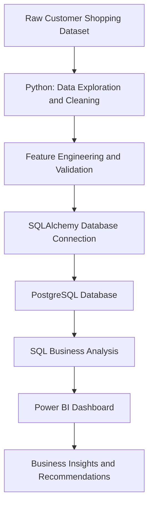

# Customer Shopping Behavior Analysis

  

An end-to-end data analytics project that transforms raw customer shopping data into actionable business insights using **Python, PostgreSQL, SQLAlchemy, and Power BI**.

> **Project goal:** Understand customer spending patterns, product preferences, discount usage, customer segments, subscription behavior, shipping preferences, and revenue contribution across age groups.

---

## Table of Contents

- [Project Overview](#project-overview)
- [Tools and Technologies](#tools-and-technologies)
- [Project Workflow](#project-workflow)
- [Dataset Overview](#dataset-overview)
- [Python Data Cleaning and EDA](#python-data-cleaning-and-eda)
- [PostgreSQL Business Analysis](#postgresql-business-analysis)
- [Key Findings](#key-findings)
- [Power BI Dashboard](#power-bi-dashboard)
- [Business Recommendations](#business-recommendations)
- [Repository Structure](#repository-structure)
- [Getting Started](#getting-started)
- [Skills Demonstrated](#skills-demonstrated)
- [Conclusion](#conclusion)

---

## Project Overview

This project analyzes **3,900 customer purchase records** to explore shopping behavior and identify patterns that can support business decisions. The workflow covers data exploration and cleaning in Python, database integration with SQLAlchemy, business analysis in PostgreSQL, and visual reporting in Power BI.

### Objectives

- Prepare and validate customer shopping data.
- Handle missing values and create useful analytical features.
- Load the cleaned dataset into PostgreSQL.
- Answer business questions with SQL queries.
- Present findings through a Power BI dashboard.
- Translate the analysis into practical business recommendations.

## Tools and Technologies

| Tool | Purpose |
|---|---|
| Python | Data cleaning, exploration, and feature engineering |
| Pandas and NumPy | Data manipulation and numerical operations |
| PostgreSQL | Relational data storage and SQL analysis |
| SQLAlchemy | Connecting Python to PostgreSQL and loading data |
| Power BI | Dashboard development and visual reporting |
| Git and GitHub | Version control and project documentation |

## Project Workflow

## Dataset Overview

The dataset contains **3,900 rows and 18 columns**.

Key data areas include:

- **Customer demographics:** Age, gender, location, and subscription status.
- **Purchase details:** Item purchased, category, purchase amount, season, size, and color.
- **Shopping behavior:** Discount applied, previous purchases, purchase frequency, review rating, and shipping type.

The project documentation records **37 missing values** in the `Review Rating` column.

## Python Data Cleaning and EDA

Python was used to prepare the dataset for analysis.

- Loaded the dataset using Pandas.
- Inspected its structure with `df.info()` and summary statistics with `df.describe()`.
- Checked missing values and handled missing review ratings using the median rating within each product category.
- Standardized column names to `snake_case`.
- Created an `age_group` feature by grouping customer ages.
- Created a `purchase_frequency_days` feature.
- Checked for redundancy between `discount_applied` and `promo_code_used` and removed `promo_code_used` as documented.
- Connected to PostgreSQL using SQLAlchemy and loaded the cleaned DataFrame into a database table.

### Python Screenshots

**Initial data exploration**

  

**Data cleaning and missing values**

  

**Feature engineering**

  

  

## PostgreSQL Business Analysis

PostgreSQL was used to answer ten business questions about customer spending and shopping behavior.

| # | Business question | SQL techniques |
|---|---|---|
| 1 | What is the total revenue generated by male versus female customers? | `SUM()`, `GROUP BY` |
| 2 | Which customers used a discount and spent at least the average purchase amount? | `WHERE`, subquery, `AVG()` |
| 3 | Which five products have the highest average review ratings? | `AVG()`, `ROUND()`, `ORDER BY`, `LIMIT` |
| 4 | How do average purchase amounts compare between Standard and Express shipping? | `AVG()`, filtering, `GROUP BY` |
| 5 | How do subscriber and non-subscriber counts, average spending, and total revenue compare? | `COUNT()`, `AVG()`, `SUM()` |
| 6 | Which five products have the highest percentage of discounted purchases? | `CASE WHEN`, conditional aggregation |
| 7 | How many customers fall into New, Returning, and Loyal segments? | CTE, `CASE WHEN`, `GROUP BY` |
| 8 | What are the top three products within each category? | CTE, aggregate functions, `DENSE_RANK()` |
| 9 | How do subscription statuses compare among customers with more than five previous purchases? | Filtering, `COUNT()`, `GROUP BY` |
| 10 | What is the revenue contribution of each age group? | `SUM()`, `GROUP BY`, `ORDER BY` |

### SQL Screenshots

**Revenue analysis**

  

**Window functions**

  

**Customer segmentation**

  

## Key Findings

Based on the initial SQL analysis:

- Male customers generated higher total revenue than female customers.
- **827 customers** used a discount and spent at least the overall average purchase amount.
- The five products with the highest average review ratings were **Gloves, Sandals, Boots, Hat, and Skirt**.
- Express shipping had a higher average purchase amount than Standard shipping.
- The initial comparison did not indicate that subscribers spend more overall.
- Products with the highest discount rates included **Hat, Sneakers, Coat, Sweater, and Pants**.
- The largest customer segment was Loyal, followed by Returning and New customers, according to the project's segmentation rules.
- The initial repeat-buyer analysis did not show a positive subscription pattern.
- **Young Adult** customers contributed the highest revenue among the age groups.

> **Note:** These findings reflect the initial analysis. Validate the final results against the saved SQL queries and dashboard before using them in business decisions. The top-three-products-per-category query should rank products by purchase count or quantity if the intention is to identify the most purchased products.

## Power BI Dashboard

Power BI is used as the visual reporting layer to communicate customer shopping trends and business insights.

Add your actual dashboard screenshots to the repository's `images/` folder. The image paths below are placeholders; replace them with screenshots that match your completed dashboard.

### Dashboard Overview

  

### Revenue Analysis

  

### Customer Segmentation

  

### Product and Discount Analysis

  

## Business Recommendations

Based on the patterns identified in the analysis, the following actions could be explored:

1. **Subscription growth:** Investigate barriers to subscription and test whether exclusive benefits improve subscription uptake.
2. **Customer loyalty:** Consider rewards for repeat buyers and campaigns that encourage returning customers to become loyal customers.
3. **Discount optimization:** Review discount performance while monitoring profit margins and the relationship between discounts and purchase value.
4. **Product positioning:** Use high-rated and popular products in relevant marketing campaigns.
5. **Targeted marketing:** Focus on high-revenue age groups and evaluate customer preferences for express shipping.

These are recommendations for further testing, not claims that the strategies have already produced measurable improvements.

## Skills Demonstrated

- Data cleaning and preprocessing
- Exploratory data analysis (EDA)
- Feature engineering with Pandas
- Python and NumPy
- PostgreSQL and analytical SQL
- Aggregations, subqueries, CTEs, and window functions
- Python-to-database integration using SQLAlchemy
- Power BI reporting and visualization
- Business insight generation
- Technical documentation and GitHub project presentation

### Project Presentation

  <a href="https://customer-shopping-behavi-0l1is5n.gamma.site/" target="_blank">
    <strong>📊 View Project Presentation</strong>
  </a>

## Conclusion

This project demonstrates an end-to-end data analytics workflow, from raw data preparation to SQL-based business analysis and Power BI reporting. It applies Python, PostgreSQL, and data visualization to investigate customer shopping behavior and translate analytical results into potential business actions.

The project also provides a foundation for further work, such as validating findings, improving customer segmentation, and measuring the effectiveness of discounts and subscription campaigns.
